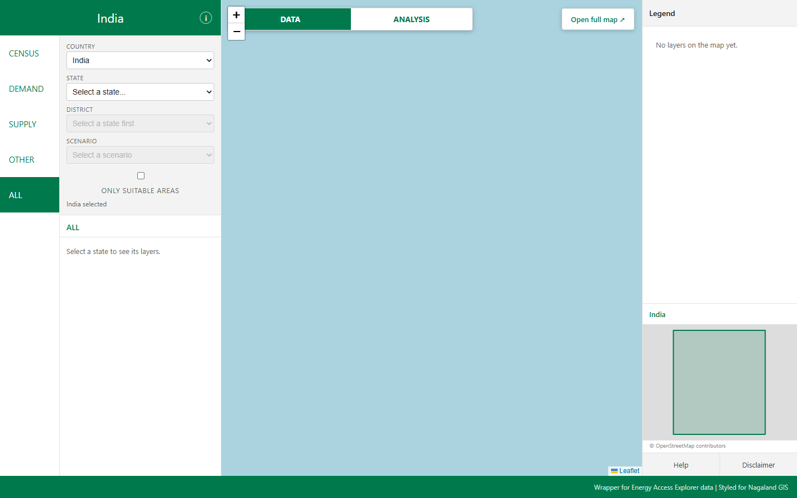
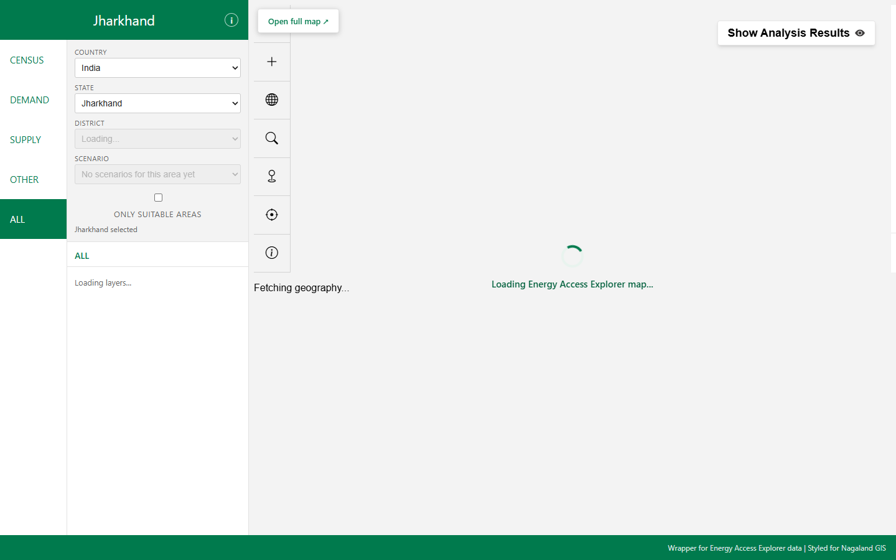
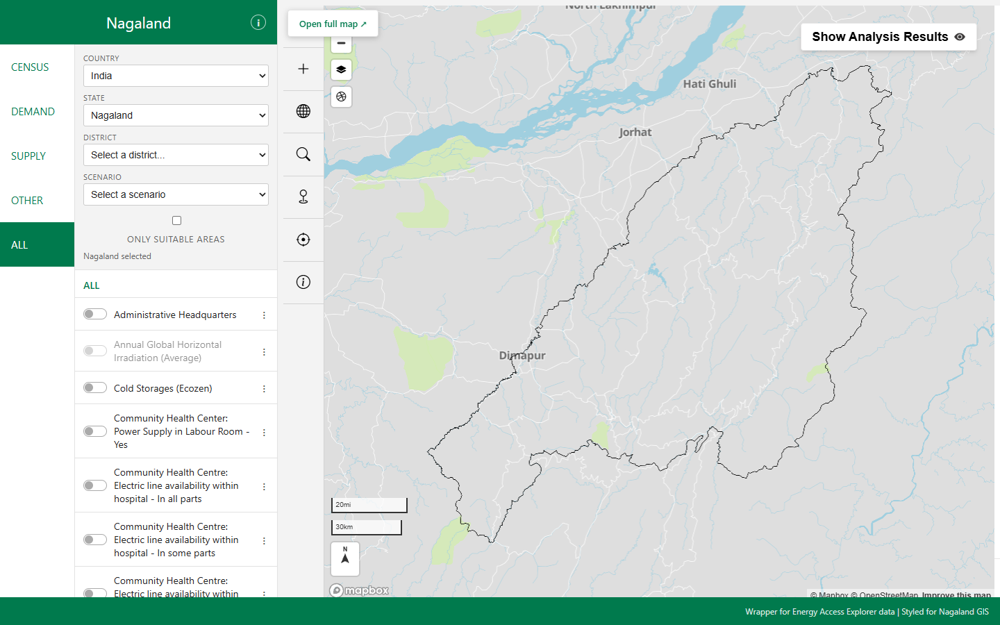
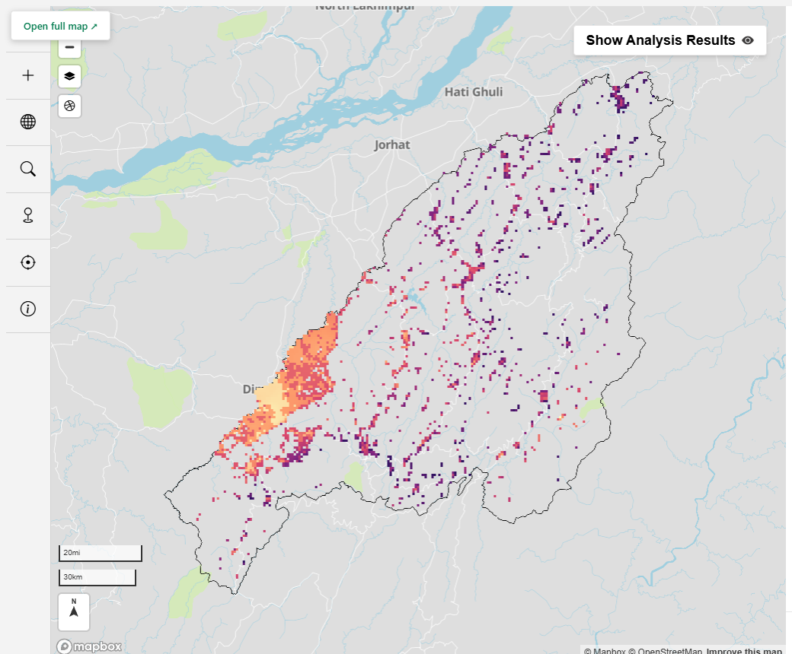
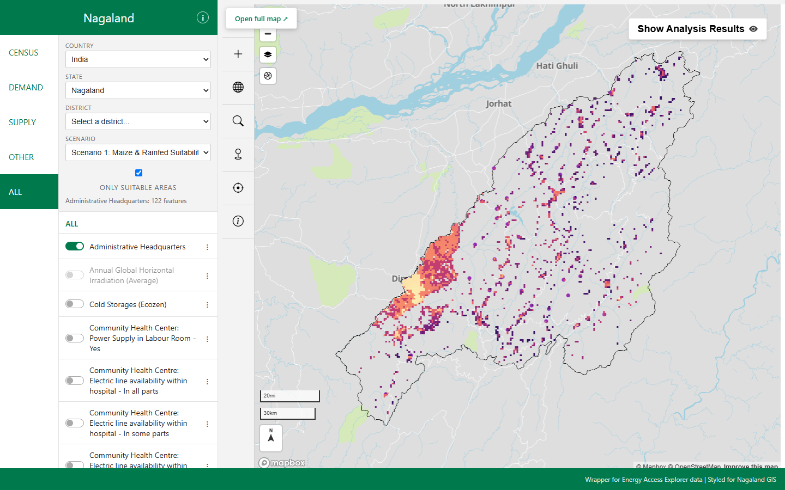
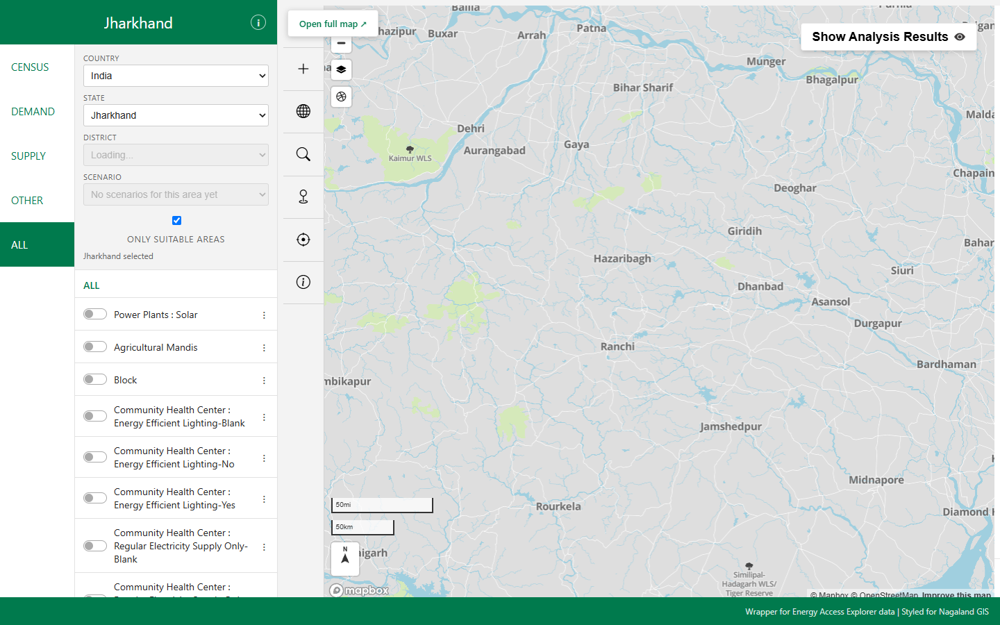
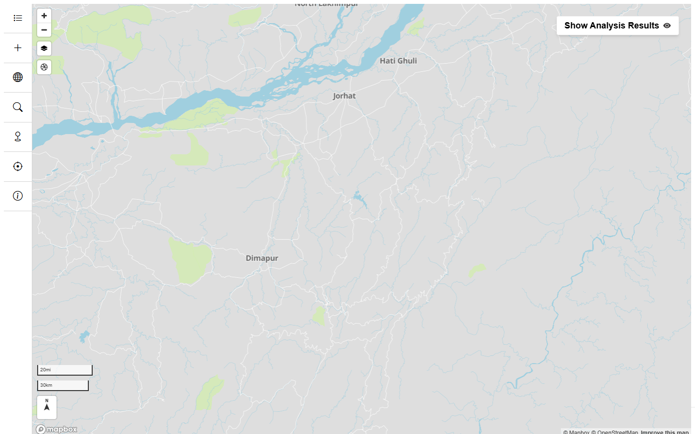

# Pull Request: Merge `dev` into `main`

**Title Suggestion:**  
`feat: complete EAE interactive iframe wrapper with boundary, scenario controls, and documentation`

---

## Linked Issue
Closes # [Insert issue number, e.g., #1]  
Refs # [Insert relevant discussion/sub-task issue if applicable]

---

## Problem & Background
Energy Access Explorer (EAE) provides detailed spatial multi-criteria analysis for energy planning, but its full interface is designed for GIS practitioners and presents a steep learning curve for non-technical stakeholders (regional planners, agricultural extension officers, and local administrators). Users who simply want to see energy suitability for a specific administrative boundary or intervention are often overwhelmed by dozens of active layers, sliders, and navigation panels.

This pull request introduces a standalone, portable wrapper webpage adapted from the visual design of [nagalandgis.in](https://nagalandgis.in/). It embeds the real EAE WebGL map inside a responsive iframe while providing clean, simplified controls for selecting administrative boundaries (Country $\rightarrow$ State $\rightarrow$ District), switching preconfigured mentor crop scenarios, and toggling criteria suitability masks.

---

## What Changed

### 1. Embedded EAE Map Controller (`src/embed.js`)
- Implemented `EaeController` managing the iframe lifecycle (`?embed=1` mode).
- Developed a bidirectional `window.postMessage` communication protocol:
  - Receives `eae:ready` containing the full administrative division tree directly from EAE.
  - Receives debounced `eae:view` camera updates (`zoom` and `center: { lng, lat }`).
  - Sends `eae:ping` retries to guarantee handshake recovery if the parent window was not listening upon initial load.
  - Sends `eae:set` messages to update districts (`divtier`, `subdiv`), camera bounds, view tabs, criteria masks, and exact layer visibility (`layers: { on, off }`).
- Implemented a smart, non-blocking 60-second readiness timeout that prevents `#eae-error` from obscuring an iframe that has already painted its DOM.
- Enforced strict origin allow-lists across `localhost` and `127.0.0.1` on ports `3000` and `8000` without wildcard (`'*'`) targeting.

### 2. User Interface & Responsive Styling (`views/index.html`, `stylesheets/style.css`)
- Replaced the initial blank frame with an interactive Leaflet world map placeholder stage (sky-blue ocean, zero-iframe DOM on initial load).
- Added Country, State, District, and Scenario dropdown controls in the left navigation sidebar.
- Added the "Only suitable areas" toggle checkbox with immediate raster criteria mask synchronisation.
- Added "Share link" (copies current URL state to clipboard) and "Open full map" (opens standalone EAE with exact matching view parameters in a new tab).
- Implemented mobile-first CSS rules supporting viewports down to 360 px width using dynamic viewport units (`100dvh`).

### 3. Application Logic & Data Integration (`src/main.js`, `src/config.js`, `src/data.js`, `src/preview.js`, `src/share.js`)
- Integrated EAE REST API client methods for fetching top-level countries, child states, and geography metadata (`/geographies`).
- Dynamic District dropdown population driven entirely by EAE's live `eae:ready` divisions payload.
- Integrated verified mentor snapshots for Nagaland (`61cc6dc7-2159-405f-a0df-6faa8c583923`):
  - **Scenario 1:** Snapshot `1791614683478` (Population Count + Annual GHI + Outline).
  - **Scenario 2:** Snapshot `1791615168733` (Schools without Electricity + Annual GHI + Outline).
- Added two-way URL state serialisation (`?country=...&state=...&district=...&scenario=...&criteria=...`) and automated view restoration upon page reload.

### 4. Documentation & Verification Materials (`README.md`, `docs/`)
- Retained the complete original challenge text at the top of `README.md`.
- Added comprehensive solution documentation, architecture ASCII diagram, complete URL parameter & postMessage contract tables, dual-server setup guide with port 3000 S3 CORS rationale, and known limitations.
- Embedded all 12 screenshots in `docs/screenshots/` showcasing key user interaction flows.
- Added `README_CLAIMS_CHECK.md` auditing all 42 factual documentation claims against the code.

---

## Visual Showcase (Screenshots)

All screenshot assets are tracked in `docs/screenshots/` and render directly:

### 1. Default World View
Initial page load showing the Leaflet world map placeholder stage with no geography selected:  


### 2. Country Selection (India)
Placeholder map automatically frames the national boundary of India while awaiting state selection:  


### 3. Tool Direct Embed Mode
Direct standalone view of the EAE analysis screen running with `?embed=1` (navigation chrome and feedback button hidden):  


### 4. Nagaland Loaded in Embed Mode
Nagaland state loaded inside the wrapper iframe with left and right panels collapsed on initial load:  


### 5. State Fallback & Scenario Guard (Jharkhand)
Selecting a state without mentor crop scenarios (e.g., Jharkhand) dynamically disables the scenario dropdown while rendering the state boundary:  


### 6. District Zoom (Kohima)
Selecting Kohima from the dynamically populated district dropdown zooms the camera and renders the district outline without reloading the iframe:  


### 7. Scenario 1 Applied (Population Count & Solar GHI)
Selecting Scenario 1 loads the preconfigured mentor snapshot (`1791614683478`):  


### 8. Criteria Mask Active ("Only suitable areas")
Checking "Only suitable areas" executes the criteria suitability filter on the raster canvas via postMessage:  


### 9. Dataset Layer Toggling & Synchronization
Activating individual layers (such as District Boundaries or Solar GHI) synchronizes exact layer visibility without removing the geography outline:  


### 10. URL State Restoration
Re-opening the page with query parameters (`?country=...&state=...&district=...&scenario=...&criteria=1`) restores all selections and map state:  


### 11. Loading State & Standalone Fallback Link
Interactive loading spinner during initialization, with an "Open standalone map" fallback link:  


### 12. Mobile Responsive Layout (360 px Viewport)
Full interface and map canvas adapt seamlessly to narrow phone viewports:  


---

## Impact & Behavioral Review

- **Who Benefits:** Regional decision-makers, hackathon jurors, and partners evaluating agricultural and energy planning interventions.
- **Normal EAE Tool Behavior:** Standalone EAE remains completely unaffected; embed features run only when `?embed=1` is explicitly passed.
- **Breaking Changes:** None. All wrapper code is strictly additive and runs in its own frontend environment.
- **Why Port 3000 is Required:** The upstream WRI Amazon S3 data bucket (`https://wri-public-data.s3.amazonaws.com/EnergyAccess/`) permits browser CORS requests originating from `http://localhost:3000`. Serving the tool on other ports results in HTTP 403 Forbidden errors when loading raster tiles.

---

## How to Test Locally

### 1. Run the Tool Fork (Port 3000)
In the companion `tool` repository:
```bash
# Compile and build the analysis screen
npx tsc -p .
wsl bash -c "cd '/path/to/tool' && bmake build-a"

# Serve on port 3000
npx http-server serve -p 3000 -c-1 --cors
```

### 2. Run the Wrapper Webpage (Port 8000)
In this repository (`oseas26-eae-wrapper-webpage`):
```bash
npx http-server -p 8000 -c-1 --cors
```

### 3. Verification Steps
1. Navigate to `http://localhost:8000/views/index.html` in Chrome.
2. Confirm the world map placeholder appears and dropdowns are in their initial empty state.
3. Select **Country:** `India` $\rightarrow$ **State:** `Nagaland`. Verify the loading spinner appears and EAE loads with side panels collapsed.
4. Select **District:** `KOHIMA`. Confirm the map smoothly moves to Kohima without reloading the iframe.
5. Select **Scenario:** `Scenario 1`. Verify datasets load.
6. Check **Only suitable areas**. Verify the criteria mask filters the canvas.
7. Click **Share link** and confirm the URL is copied to the clipboard. Paste the link into a new tab and confirm state restores accurately.
8. Click **Open full map** and verify it opens standalone EAE with matching coordinates.
9. Open DevTools, switch to Mobile Device Mode at 360 px width, and confirm layout responsiveness.

---

## Test Results Summary

| Test / Check | Command or Method | Result | Notes |
| :--- | :--- | :--- | :--- |
| **Wrapper HTTP Server** | `npx http-server -p 8000 -c-1` | **PASS (HTTP 200)** | Static asset serving verified |
| **Tool HTTP Server** | `npx http-server serve -p 3000 -c-1` | **PASS (HTTP 200)** | S3 data bucket CORS permitted |
| **Tool Unit Tests** | `node --experimental-strip-types --test test/embed.test.ts` | **PASS (4/4)** | Bounds, params, and layer matching |
| **Full Tool Suite** | `node --experimental-strip-types --test test/*.test.ts` | **46 PASS / 2 FAIL** | 2 legacy tests fail on unbuilt `lib/` symlinks |
| **End-to-End Test Suite** | `tool/e2e/run.js` (Playwright) | **Passed Core Tests** | Captured in `tool/e2e/results/` |
| **Cross-Origin Security** | Static Code Analysis | **PASS** | Origin checks on all postMessage calls; no `*` targets |

---

## Known Limitations & Out of Scope
1. **Mock Analyses Only:** EAE contains energy access and infrastructure data, not agricultural crop models. Scenarios 1 and 2 are mentor-provided proxies for Nagaland.
2. **Nagaland Scope for Scenarios:** Scenarios are configured exclusively for Nagaland state UUID `61cc6dc7-2159-405f-a0df-6faa8c583923`. Other geographies currently disable the scenario dropdown.
3. **Public Cloud Deployment Blocked:** Direct hosting on public cloud domains (e.g. GitHub Pages) is blocked because the S3 data bucket CORS policy only permits whitelisted origins. Resolving this requires the challenge maintainers to update the bucket CORS headers.
4. **Physical Mobile Device Testing:** Layout was verified via browser emulation down to 360 px width; physical mobile hardware touch testing was not performed.

---

## Checklist
- [x] Merged clean feature branches into `dev`
- [x] PR targets `main` branch
- [x] Conventional Commits title format (`feat:`)
- [x] No secrets, private API tokens, or local absolute paths committed
- [x] Build artifacts (`dist/`, `tsbuild/`, `node_modules/`) omitted
- [x] Complete documentation and claims verification matrix added
- [x] All 12 screenshots captured, tracked in `docs/screenshots/`, and rendered inline
- [x] Tested locally against running EAE tool server on port 3000
