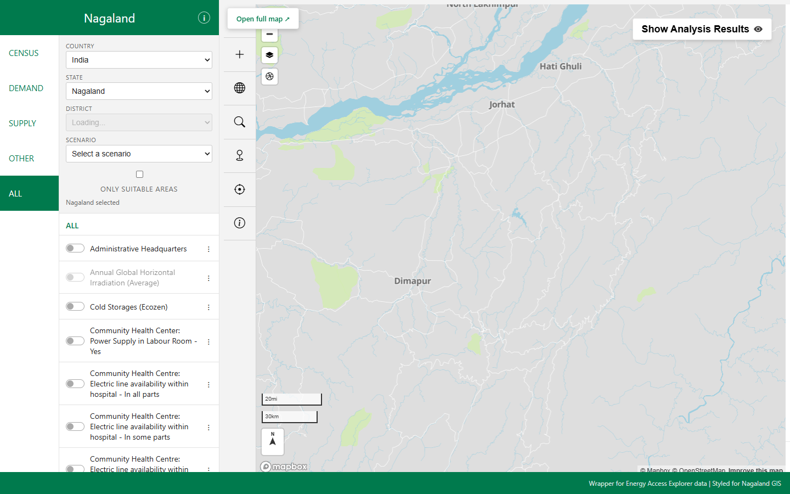
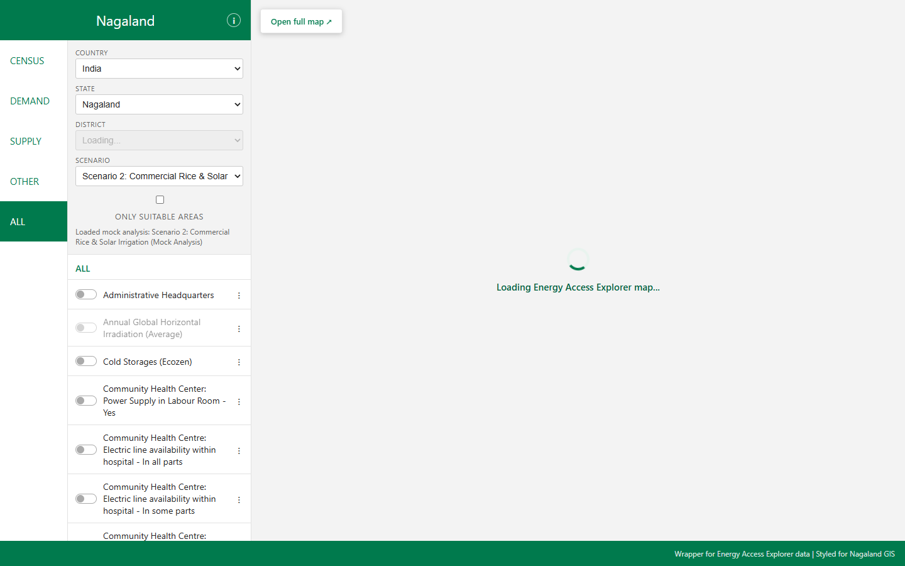

<p align="center">
  <a href="https://github.com/EnAccess/oseas26-eae-wrapper-webpage">
    
  </a>
</p>
<p align="center">
    October 26-27 | Open Source in Energy Access Symposium Hackathon | Kigali, Rwanda
</p>

---

# A wrapper webpage for EAE's Analysis

A basic webpage that embeds the
[Energy Access Explorer (EAE)](https://www.energyaccessexplorer.org) analysis in
an interactive, preconfigured map window.

## Abstract and goal

A basic webpage should be developed with the Energy Access Explorer (EAE)
platform embedded within a map window, similar to a Leaflet-based
implementation. The webpage design and layout can be adapted from the template
used on <https://nagalandgis.in/> and integrated as an additional page within the
existing website.

The embedded EAE map should be configured with an appropriate default zoom level
and responsive sizing to ensure optimal viewing and usability across both desktop
and mobile devices. When the page loads, the left and right side panels of EAE
should be collapsed by default to maximize the visible map area.

The webpage should provide user controls for selecting two key parameters that
are linked to the embedded EAE platform:

- Administrative boundary hierarchy
- Crop names

Based on the user's selections, the webpage should enable users to automatically
zoom to the selected administrative boundary and visualize or highlight areas
identified as suitable for growing the selected crop. The required administrative
boundary layers will be preloaded within the EAE platform, and a set of mock crop
suitability analyses will be provided to support the development and testing of
the webpage functionality.

## Expected outcomes

- An iframe which allows users to have an interactive map of the pre-selected
  data embedded on an HTML page. It will render the map with your exact dataset
  combinations and legend.
- A live mirror of EAE where the map remains fully interactive. This means
  visitors to the wrapper website will still be able to move sliders around or
  zoom in and out if they choose to explore the data further.

## Required knowledge

### Stack

- iframe-based implementation.
- Embedded EAE map with preset data and configuration in a wrapper webpage.

EAE is written in plain/modern JavaScript (ECMAScript 2020). There is no
framework; instead a traditional C-style programming pattern is enforced. The
directories contain:

- `src`: JavaScript code
- `stylesheets`: CSS code
- `views`: HTML documents
- `bin`: scripts and executables

### Helpful experiences

- Experience in UI/UX.
- Experience with iframe.
- Familiarity with web mapping and UI tools.

## Person of contact supporting this challenge

- Akansha Saklani
- Abdul Khalid

## Getting started

- Join the OSEAS Discord server: <https://community.oseas.org/>
- Introduce yourself in the `#introductions` channel and join the relevant
  channels for this challenge.
- For physical participants: bring a computer (and required adapters) for some
  hacking.
- Read the documentation:
  - [Energy Access Explorer](https://www.energyaccessexplorer.org)
  - [EAE GitHub](https://github.com/energyaccessexplorer)
  - [EAE Technical Note](https://www.wri.org/research/energy-access-explorer-data-and-methods?ap3c=IGaj6AgspJqgeKwBAGaj6AgmzCZ5Iv70Fr7H6ahniwtFr1FOgg)

---

# Solution Documentation

## 1. What this is

Energy Access Explorer contains high-resolution geospatial datasets for energy planning, but its interface requires familiarity with spatial multi-criteria analysis to locate areas suitable for specific interventions. This wrapper webpage embeds the Energy Access Explorer map in an iframe, allowing users to pick an administrative boundary and a scenario while retaining map interactivity.

What is not done: actual crop models do not exist in EAE; scenario data is restricted to mentor mock snapshots for Nagaland, and public hosting is blocked by AWS S3 CORS restrictions on the data bucket (see [Known limitations](#9-known-limitations)).

## 2. Demo

Key interactions from the automated test run:

### 1. Default World View
Initial page load showing the Leaflet world map placeholder before any geography is selected:


### 2. Nagaland Loaded in Embed Mode
Nagaland state loaded inside the EAE iframe with top chrome hidden and side panels collapsed:


### 3. District Zoom (Kohima)
District selection automatically zooming the camera to Kohima with administrative boundaries:


### 4. Scenario 1 (Population Count & Solar GHI)
Preconfigured mentor snapshot loaded without full page refresh:


### 5. Criteria Mask (Only Suitable Areas)
Suitability criteria filter active, highlighting suitable areas on the EAE canvas:


### 6. Mobile 360 px Viewport
Responsive interface rendered at 360 px width:


## 3. Challenge requirements and status

| Challenge Requirement | Status | Where in code |
| :--- | :--- | :--- |
| Embed EAE analysis in an iframe window | Implemented (code) | `src/embed.js:156-226`, `views/index.html:160-170` |
| Panels collapsed by default on load | Implemented (code) | `tool/src/a.js:525` (`if (!window.EMBED) left_panel("cards");`) |
| Sensible default zoom on load | Implemented (code) | `src/config.js:10-12` (`DEFAULT_ZOOM = 8`, `DEFAULT_CENTER = {lng: 94.5, lat: 26.1}`) |
| Responsive desktop and mobile layout (incl. 360 px) | Implemented (code) | `stylesheets/style.css:1124-1147` (`@media (max-width: 480px)`) |
| Administrative boundary selection linked to map | Implemented (code) | `src/main.js:602-612`, `src/embed.js:127-132` (`onDivisionsLoaded`) |
| Crop / Scenario controls linked to map | Implemented (code) | `src/config.js:71-86` (`CROPS`), `src/main.js:775-812` |
| Zoom to selected administrative boundary | Implemented (code) | `src/main.js:672-684` (`districtSel` sends `divtier: 1, subdiv: id`) |
| Visualise suitable areas (criteria toggle) | Implemented (code) | `src/main.js:815-822` (sends `criteria: bool`), `tool/src/embed.js:215-219` |
| Live mirror where map remains interactive | Implemented (code) | `tool/src/embed.js:112-142` (`moveend` sends `eae:view`) |
| Additional page integration (portable addresses) | Implemented (code) | `src/config.js:3-7` (`API`, `EAE_APP`, `EAE_ORIGIN`) |
| Visual styling adapted from nagalandgis.in | Implemented (code) | `stylesheets/style.css:1-120` (palette, typography, layout) |
| Hosted iframe URL on cloud domain | Blocked | `src/config.js:6` (data bucket S3 CORS rejects non-localhost origins) |

## 4. How it works

```
+-------------------------------------------------------------+
| Wrapper Webpage (http://localhost:8000)                     |
|                                                             |
|  [Country v] [State v] [District v] [Scenario v]            |
|  [x] Only suitable areas                                    |
|                                                             |
|  +-------------------------------------------------------+  |
|  | <iframe> (http://localhost:3000/tool/a/?id=...&embed=1)|  |
|  |                                                       |  |
|  |   EAE Mapbox GL Canvas                                |  |
|  |   (Controls hidden, panels collapsed)                 |  |
|  +-------------------------------------------------------+  |
+-------------------------------------------------------------+
```

### URL Parameters (Wrapper -> EAE Tool iframe)

Constructed in `src/embed.js:156-175`:

| Parameter | Type | Purpose | Code Reference |
| :--- | :--- | :--- | :--- |
| `id` | UUID string | Selected geography identifier (e.g., Nagaland UUID) | `src/embed.js:157-159` |
| `embed` | `"1"` | Activates embed mode (collapses panels, hides header) | `src/embed.js:160` |
| `snapshot` | string | Timestamp ID of analysis snapshot | `src/embed.js:162` |
| `zoom` | number string | Initial map zoom level | `src/embed.js:163` |
| `lng`, `lat` | number strings | Initial map center longitude and latitude | `src/embed.js:164-167` |
| `divtier` | number string | Administrative tier level | `src/embed.js:168` |
| `subdiv` | number string | Administrative subdivision identifier | `src/embed.js:169` |
| `view` | string | Active screen tab (`"data"` or `"analysis"`) | `src/embed.js:170` |
| `criteria` | `"1"` or `"0"` | Sets criteria suitability filter state | `src/embed.js:171` |

### PostMessage Protocol

All cross-frame messages use `window.postMessage`.

#### From Tool Fork to Wrapper

| Message Type | Payload Structure | Trigger | Receiver in Wrapper |
| :--- | :--- | :--- | :--- |
| `eae:ready` | `{ type: "eae:ready", divisions: [{ tier, name, entries: [{ id, name }] }] }` | Tool initialization completed or in response to `eae:ping` | `src/embed.js:112-144` |
| `eae:view` | `{ type: "eae:view", zoom: number, center: { lng: number, lat: number } }` | Mapbox `moveend` event debounced by 500 ms | `src/embed.js:145-153` |

#### From Wrapper to Tool Fork

| Message Type | Field | Type | Action in Tool Fork |
| :--- | :--- | :--- | :--- |
| `eae:ping` | `type: "eae:ping"` | string | Tool replies immediately with `eae:ready` and divisions payload (`tool/src/embed.js:149-159`) |
| `eae:set` | `divtier` | number | Sets `STATE.divtier` in tool (`tool/src/embed.js:167-171`) |
| `eae:set` | `subdiv` | number | Sets `STATE.subdiv` in tool (`tool/src/embed.js:173-177`) |
| `eae:set` | `zoom` | number | Sets map zoom (`tool/src/embed.js:180-184`) |
| `eae:set` | `center` | `{ lng, lat }` | Sets map center coordinates (`tool/src/embed.js:186-190`) |
| `eae:set` | `bounds` | `[minX, minY, maxX, maxY]` | Validates bounding box and calls `mapbox_fit` (`tool/src/embed.js:193-205`) |
| `eae:set` | `view` | string | Sets active view (`tool/src/embed.js:207-211`) |
| `eae:set` | `criteria` | boolean | Toggles criteria mask via `window.setCriteriaMask` (`tool/src/embed.js:214-219`) |
| `eae:set` | `layers` | `{ on: string[], off: string[] }` | Enables or disables layers by exact name or ID, protecting boundary layers (`tool/src/embed.js:222-254`) |

## 5. Run it locally

### Why Port 3000 is Required for the Tool

The upstream WRI Amazon S3 data bucket (`https://wri-public-data.s3.amazonaws.com/EnergyAccess/`) enforces Cross-Origin Resource Sharing (CORS). Requests originating from `http://localhost:3000` are permitted by the bucket CORS rules, whereas arbitrary ports or foreign domains receive HTTP 403 Forbidden errors when fetching GeoTIFF raster tiles and vector files.

### Step 1: Build and Run the Tool Fork (Port 3000)

Refer to the tool repository documentation (`tool/README.md`) for build environment requirements (Node.js, bmake, jq, and a Mapbox public access token).

In the `tool` repository directory:

```bash
# 1. Compile TypeScript source modules
npx tsc -p .

# 2. Assemble distribution using BSD Make (via WSL on Windows)
wsl bash -c "cd '/mnt/c/Users/user/Documents/The gym/react-understanding/react-project/tool' && bmake build-a"

# 3. Serve tool distribution on port 3000
npx http-server serve -p 3000 -c-1 --cors
```

### Step 2: Run the Wrapper Webpage (Port 8000)

In this repository directory:

```bash
npx http-server -p 8000 -c-1 --cors
```

*(Alternatively, run `python server.py` which also starts a proxy on port 8000).*

### Step 3: Open the Application

Open in a web browser:
```
http://localhost:8000/views/index.html
```

## 6. Configuration

All operational endpoints are declared in `src/config.js`:

```javascript
// src/config.js lines 3-7
const API = "https://api.energyaccessexplorer.org";
const EAE_APP = "http://localhost:3000/tool/a/";
const EAE_ORIGIN = new URL(EAE_APP).origin;
```

### Adding a Scenario

Scenarios in `src/config.js` correspond to saved EAE snapshot configurations. To configure an analysis snapshot, add an object to the `CROPS` array:

```javascript
// src/config.js lines 71-86
const CROPS = [
  {
    id: "scenario_1",
    label: "Scenario 1: Maize & Rainfed Suitability (Mock Analysis)",
    snapshot: "1791614683478",
    geography: "61cc6dc7-2159-405f-a0df-6faa8c583923",
    mock: true,
  },
  {
    id: "scenario_2",
    label: "Scenario 2: Commercial Rice & Solar Irrigation (Mock Analysis)",
    snapshot: "1791615168733",
    geography: "61cc6dc7-2159-405f-a0df-6faa8c583923",
    mock: true,
  },
];
```

Note: "Scenario 1" and "Scenario 2" use snapshots created by mentor Abdul Khalid for Nagaland state (`61cc6dc7-2159-405f-a0df-6faa8c583923`). The underlying datasets in these snapshots are:
- Snapshot `1791614683478`: Population Count, Annual Global Horizontal Irradiation (Average), Outline.
- Snapshot `1791615168733`: Annual Global Horizontal Irradiation (Average), Schools without Electricity, Outline.

They do not contain actual crop yield or crop agronomy data.

## 7. Using it on another site

To embed this wrapper as an additional sub-page on an existing site (such as nagalandgis.in):

1. **Files to copy**:
   - `views/index.html` (the page layout)
   - `stylesheets/style.css` (visual styles)
   - `src/` directory (`config.js`, `data.js`, `embed.js`, `main.js`, `preview.js`, `share.js`)
2. **Settings to update**:
   - In `src/config.js`, change `EAE_APP` to the public URL hosting the patched tool fork.
   - In the tool fork's `.env`, add the parent site origin to `EMBED_ORIGINS` (e.g., `EMBED_ORIGINS="https://nagalandgis.in"`).
3. **Bucket permissions**:
   - The S3 data bucket hosting EAE raster/vector layers must allow the parent origin in its CORS configuration.

## 8. Tests

### Automated Unit Tests

Automated tests reside in the `tool` fork repository. The wrapper repository has no standalone unit test runner.

Command executed in `tool`:
```bash
node --experimental-strip-types --test test/*.test.ts
```

Result:
- Total tests: 48
- Passing: 46
- Failing: 2 (`even-label-indices.test.ts` and `locale-policy.test.ts` fail when run without compiled `lib/` dependencies).
- Embedded module unit tests (`test/embed.test.ts`): 4/4 passing (verifies camera parsing, input validators, bounding boxes, and layer filters).

### Manual Test Verification Checklist

1. **Initial Screen**: Load `http://localhost:8000/views/index.html`. Verify that Leaflet world placeholder map displays and no iframe is loaded.
2. **State Selection**: Select Country `India`, then State `Nagaland`. Verify iframe initiates, loader spinner appears, and Nagaland boundaries render.
3. **District Selection**: Confirm District dropdown populates with entries from `eae:ready` payload (e.g., `KOHIMA`). Select `KOHIMA` and verify map zooms to district bounds.
4. **Scenarios**: Select `Scenario 1`. Verify snapshot `1791614683478` loads datasets.
5. **Criteria Mask**: Check `Only suitable areas`. Verify `eae:set` message toggles suitability filter.
6. **Layer Toggling**: Toggle `Power Plants : Solar`. Verify layer renders without removing boundary outline.
7. **URL Persistence**: Reload browser with query string `?country=...&state=...`. Verify selections restore automatically.

## 9. Known limitations

1. **Mock analyses only**: EAE contains energy access and infrastructure data, not agricultural crop models. Scenarios represent proxy energy infrastructure combinations.
2. **Nagaland only for scenarios**: Scenarios 1 and 2 are configured exclusively for Nagaland state UUID `61cc6dc7-2159-405f-a0df-6faa8c583923`. For other geographies (e.g., Jharkhand), the scenario dropdown is disabled.
3. **Hosted deployment blocked**: Cloud hosting on third-party domains is blocked by AWS S3 CORS headers on `wri-public-data.s3.amazonaws.com`.
4. **No physical mobile device testing**: Responsive behavior has been verified via browser emulation down to 360 px width, but not on physical mobile hardware.
5. **Initial load duration**: First load of the EAE WebGL map engine downloads multiple GeoTIFF files and vectors, requiring 5 to 15 seconds depending on connection speed.
6. **Design review**: Layout colors and header structure are adapted from nagalandgis.in, but have not undergone formal design review with the Nagaland GIS team.

## 10. Troubleshooting

| Symptom | Cause | Fix |
| :--- | :--- | :--- |
| HTTP 404 at `/tool/a/` | Tool assets not built or output not placed in `dist/` | Run `wsl bash -c "bmake build-a"` in the tool repo before starting server. |
| White blank page with `pptxgen.js` syntax error | Outdated third-party export dependency during assembly | Recompile using `bmake build-a` with current template scripts. |
| UI changes not appearing in browser | Browser caching older JavaScript bundles | Hard reload the browser (`Ctrl + Shift + R` or `Cmd + Shift + R`) or update script cache buster query string in `views/index.html`. |
| Iframe shows indefinite loading spinner | `settings.json` contains `TODO_` values or Mapbox access token is invalid | Populate `MAPBOX_TOKEN` in `tool/.env` with a valid token and rebuild. |
| Map tiles load but data layers fail with CORS errors | Tool served from an origin not permitted by the data bucket | Serve the tool fork strictly on port `3000` (`http://localhost:3000`). |

## 11. Project structure

```
oseas26-eae-wrapper-webpage/
├── .github/
│   ├── ISSUE_TEMPLATE/
│   │   ├── bug_report.yml
│   │   ├── config.yml
│   │   └── feature_request.yml
│   ├── PULL_REQUEST_TEMPLATE.md
│   └── SECURITY.md
├── .vscode/
│   └── settings.json
├── docs/
│   └── screenshots/          # Image placeholders for interaction flow
├── src/
│   ├── config.js             # API URLs, default coordinates, mentor scenarios
│   ├── data.js               # EAE REST API client methods
│   ├── embed.js              # Iframe lifecycle, postMessage interface
│   ├── main.js               # UI event listeners and dropdown controllers
│   ├── preview.js            # Leaflet stage placeholder and mini-map
│   └── share.js              # URL clipboard sharing handler
├── stylesheets/
│   └── style.css             # Responsive styling and color palette
├── views/
│   ├── index.html            # Primary application page
│   └── spike.html            # Prototype iframe spike
├── AI_HELP_LOG.md            # Log of AI-assisted modifications
├── CODE_OF_CONDUCT.md        # Community conduct standards
├── CONTRIBUTING.md           # Contribution guidelines
├── DISCORD_ETIQUETTE.md      # Communication etiquette
├── Guide.md                  # Hackathon team working guide
├── package-lock.json
├── README.md                 # Project documentation and challenge description
├── server.py                 # Optional Python localhost server with S3 proxy
└── SPIKE_RESULTS.md          # Technical notes from initial spike test
```

## 12. Credits and licence

- **Energy Access Explorer (EAE)**: Licensed under the MIT Licence by the World Resources Institute. Consult the [EAE Attribution Page](https://www.energyaccessexplorer.org/attribution) before deploying.
- **Challenge Organisers**: Open Source in Energy Access Symposium (OSEAS) Hackathon, Kigali, Rwanda (October 2026).
- **Mentorship Support**: Akansha Saklani (Challenge Mentor), Abdul Khalid (EAE Lead / Challenge Mentor).

## 13. Contributing

Fork this repository, create a descriptive feature branch (`git switch -c feat/your-feature`), and submit changes via a GitHub pull request. PR titles must adhere to the Conventional Commits specification (`feat:`, `fix:`, `docs:`, `chore:`). Refer to [CONTRIBUTING.md](./CONTRIBUTING.md) and the [OSEA Guide](./Guide.md) for collaboration norms. All AI-assisted changes must be logged in `AI_HELP_LOG.md`.
